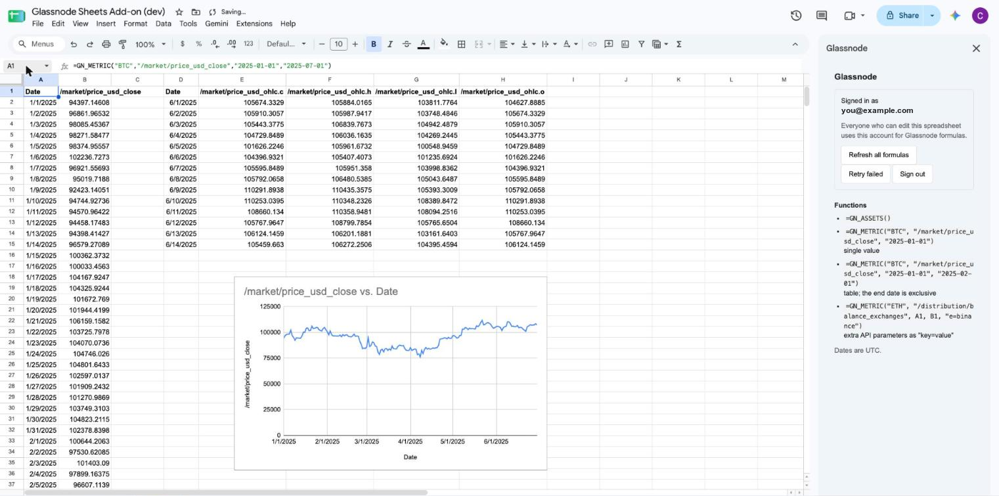
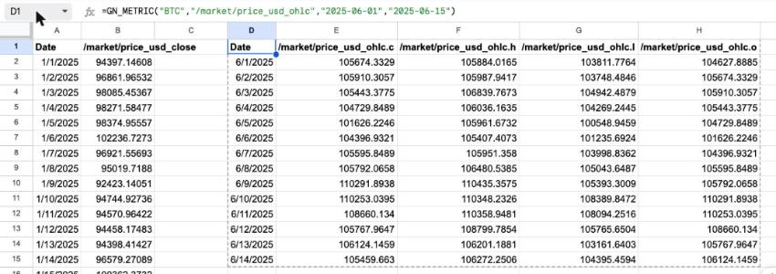
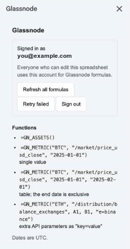

# `glassnode-google-sheets`

[](https://github.com/glassnode/glassnode-google-sheets/actions/workflows/ci.yml)
[](LICENSE)

Custom functions that pull Glassnode metrics into a Google Sheet, modelled on
the [Glassnode Excel add-in](https://github.com/glassnode/glassnode-excel).



One formula per table: the results are ordinary numbers and dates, so charts,
pivot tables and other formulas work on them directly.

> **Status:** development build. It runs as a script bound to a test
> spreadsheet and points at the Glassnode dev environment. It is not published
> to the Google Workspace Marketplace.

## Contents

- [Functions](#functions)
- [Signing in](#signing-in)
- [Refreshing data](#refreshing-data)
- [Caching and rate limits](#caching-and-rate-limits)
- [Development](#development)
- [Known limitations](#known-limitations)
- [Contributing](#contributing)
- [Support](#support)
- [License](#license)

## Functions

### `GN_ASSETS([limit])`

Lists the asset IDs available on Glassnode, one per row.

```
=GN_ASSETS()
=GN_ASSETS(50)
```

### `GN_METRIC(asset, metric, startDate, [endDate], [parameters…])`

| Argument | Description |
|---|---|
| `asset` | Asset ID, e.g. `"BTC"`. |
| `metric` | Metric path in API notation, e.g. `"/market/price_usd_close"`. |
| `startDate` | A date cell, `DATE(…)`, or a `"YYYY-MM-DD"` string. Dates are UTC. |
| `endDate` | Optional, exclusive. When set, the result is a table. |
| `parameters` | Optional API parameters as `"key=value"` strings, or a range of them. |

- **Start date only:** returns the first data point on or after that date as a
  single value.
- **Start and end date:** returns a table with a header row, a `Date` column
  and one column per value.
- **Metrics with several fields** (for example OHLC) return one column per
  field, named `metric.field`. Add `"pick=field"` to return just one.
- **Resolution** defaults to daily. Pass `"i=1h"`, `"i=1w"`, `"i=1month"` and
  so on to change it.

```
=GN_METRIC("BTC", "/market/price_usd_close", "2025-01-01")
=GN_METRIC("BTC", "/market/price_usd_close", "2025-01-01", "2025-02-01")
=GN_METRIC("BTC", "/market/price_usd_close", A1, B1, "i=1h")
=GN_METRIC("BTC", "/market/price_usd_ohlc", "2025-01-01", "2025-02-01", "pick=c")
=GN_METRIC("ETH", "/distribution/balance_exchanges", "2025-07-20", "2025-07-25", "e=binance")
```



Values are real numbers and dates, so they work in charts and arithmetic.

**Sub-daily timestamps:** Sheets displays a date-time returned by a formula as
a date only. The time is there; format the column with
*Format → Number → Date time* to see it.

## Signing in



Open **Extensions → Glassnode → Open**, click **Sign in**, confirm the code in
the tab that opens and log in to Glassnode. There is no API-key option.

Sign-in uses the OAuth 2.0 device authorization flow against Glassnode's Auth0
tenant. The add-on is a public client, so the repository contains no secret.

### One session per spreadsheet

The session belongs to the spreadsheet, not to the person looking at it:

- Whoever signs in connects that spreadsheet to their Glassnode account.
- Every formula in the spreadsheet runs on that account, whoever triggers the
  recalculation. Collaborators do not sign in themselves.
- **Anyone with edit access can therefore query Glassnode on the signer's
  plan.** Share with view-only access if that is not what you want.
- Each new spreadsheet needs its own sign-in.

This is a constraint of Google Sheets rather than a choice: a custom function
cannot tell who is viewing the sheet and can only read storage that belongs to
the document or its owner.

Access tokens are refreshed automatically. The session ends when someone
clicks **Sign out**, or when the spreadsheet has not been used for 90 days.

## Refreshing data

Sheets only re-runs a custom function when its arguments change. Two actions
in the menu and the sidebar re-run formulas on demand:

- **Refresh all formulas** re-fetches everything, bypassing the cache.
- **Retry failed formulas** re-runs only the cells that show an error, for
  example after a rate limit.

## Caching and rate limits

| Request | Cached for |
|---|---|
| Metric range that ended more than a day ago | 1 hour |
| Metric range that touches today | 5 minutes |
| Asset list | 1 hour |

- Identical formulas that start together share a single API request.
- Rate limits differ per account, so none are hardcoded. The add-on reads the
  limit state from the API's response headers. Once the limit is used up,
  other cells wait for the reset when that fits in the 30 seconds Google gives
  a formula, and otherwise fail with the time at which to retry.
- Responses over roughly 90 KB are not cached.
- The cache is best-effort; Google may evict entries early.

## Development

Setup, commands and releases are in [CONTRIBUTING.md](CONTRIBUTING.md).

### Layout

| File | Purpose |
|---|---|
| `src/Config.js` | Auth0 tenant, client ID and API host. The only place that names an environment. |
| `src/Auth.js` | Device flow, session storage, token refresh, sidebar API. |
| `src/Api.js` | API client: cache, request merging, rate-limit handling. |
| `src/Functions.js` | `GN_ASSETS` and `GN_METRIC`. |
| `src/Menu.js` | Menu, sidebar, refresh and retry actions. |
| `src/Lib.js` | Pure helpers (dates, parameters, response shaping). Unit-tested. |
| `src/Sidebar.html` | Sidebar UI. |
| `src/appsscript.json` | Manifest: scopes and the allow-list of hosts the script may call. |

### Conventions

- Functions ending in `_` are private. Apps Script does not let a cell or the
  sidebar call them. Everything that touches a token is private, and the
  functions the sidebar calls return status only.
- Custom functions throw errors rather than returning error strings, so a
  failed cell shows `#ERROR!` with the message on hover.

## Known limitations

- A formula must finish within 30 seconds (a Google limit).
- With a low rate limit, a sheet with many distinct formulas needs several
  **Retry failed formulas** rounds on first load.
- In a script bound to a spreadsheet, as in this development setup, any editor
  can open the script editor and read the stored session. A published add-on
  keeps its storage private to the add-on; this has not been verified yet.

## Contributing

See [CONTRIBUTING.md](CONTRIBUTING.md): development setup, tests and releases.

## Support

Questions and bugs: GitHub Issues. Vulnerabilities: see [SECURITY.md](SECURITY.md).

## License

Apache License 2.0. See [LICENSE](LICENSE) and [NOTICE](NOTICE).
